# Host Firewall Lab with UFW on Ubuntu

**Disclaimer:** used AI for report writing and Readme, the Project and the images attached were made by me.

---

## Summary

I built a small web server inside an Ubuntu virtual machine and used **UFW (Uncomplicated Firewall)** to control who can reach it.
I tested every rule from my Windows computer on the same home network.
The lab shows how a firewall blocks traffic by default, how to open one port, how to block one computer, and why **the order of rules matters**.

## Contents

- [Lab at a glance](#lab-at-a-glance)
- [Diagram](#diagram)
- [Skills shown](#skills-shown)
- [Part A - Prepare the virtual machine](#part-a---prepare-the-virtual-machine)
- [Part B - Build a test web server](#part-b---build-a-test-web-server)
- [Part C - Turn on the firewall](#part-c---turn-on-the-firewall)
- [Part D - Block one computer and test rule order](#part-d---block-one-computer-and-test-rule-order)
- [Test results](#test-results)
- [Glossary](#glossary)
- [Disclaimer](#disclaimer)
- [Repository layout](#repository-layout)

## Lab at a glance

| Item | Value |
|---|---|
| Hypervisor (virtual machine software) | VMware Workstation 17.5 |
| Virtual machine | Ubuntu 22.04, 4 GB memory, 2 processors, 30 GB disk |
| Virtual machine name / user | `smahn-virtual-machine` / `smahn` |
| Network mode | Bridged (changed from NAT) |
| Ubuntu IP address | `192.168.18.54/24` (interface `ens33`) |
| Windows host IP address | `192.168.18.26` |
| Home router (gateway) | `192.168.18.1` |
| Web server | Python `http.server` on port **8080** (TCP) |
| Web page | `~/firewall_lab/index.html` |
| Firewall | UFW (Uncomplicated Firewall) |

## Diagram

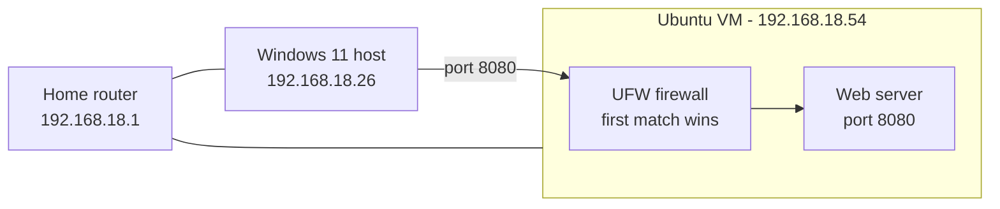

## Skills shown

- Setting up virtual machine networking (NAT vs Bridged)
- Linux command line (`mkdir`, `apt`, `ip a`, `python3`)
- Running a simple web server for testing
- Host firewall setup with UFW: enable, allow, deny, delete, numbered rules
- Understanding default-deny and **first-match rule order**
- Testing network access from a second computer

---

## Part A - Prepare the virtual machine

**Step 1.** The virtual machine's network adapter was on NAT, which hides the virtual machine behind the host.

<p align="center">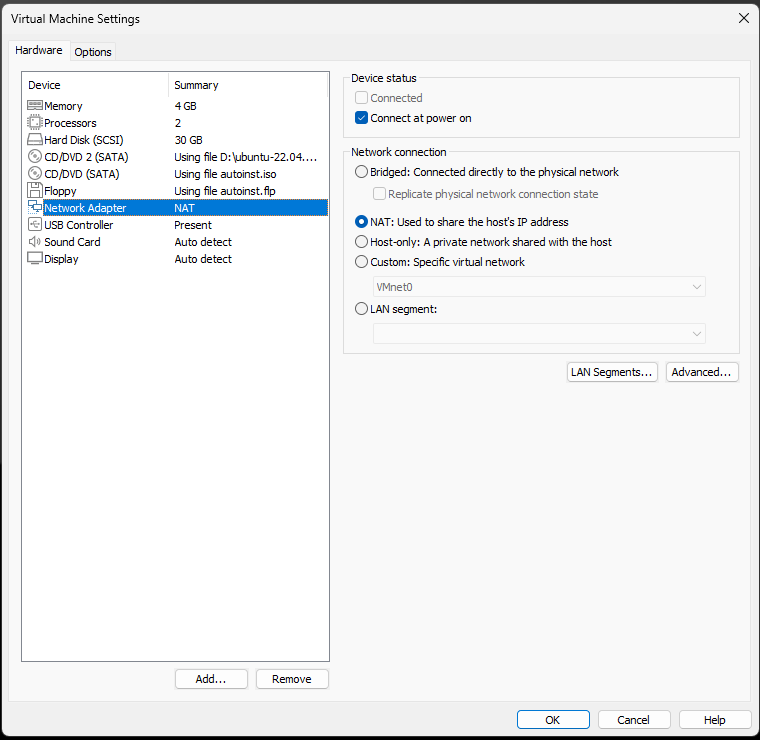<br><em>Figure 1 - Network adapter on NAT</em></p>

**Step 2.** I changed it to **Bridged**, so the virtual machine gets its own address on my home network and Windows can reach it directly.

<p align="center">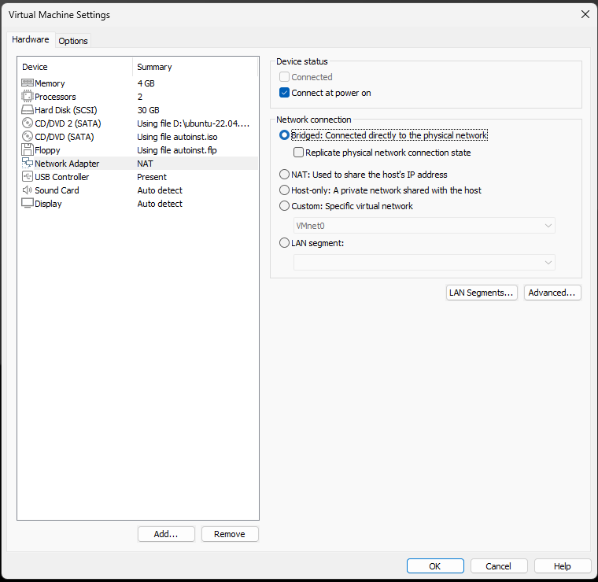<br><em>Figure 2 - Network adapter changed to Bridged</em></p>

## Part B - Build a test web server

**Step 3.** I made a folder for the lab and moved into it.

<p align="center">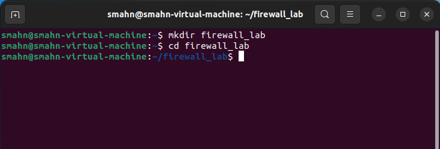<br><em>Figure 3 - Creating the firewall_lab folder</em></p>

**Step 4.** I made sure the gedit text editor was installed, then used it to write `index.html` with one line: *"I'm able to see this through the firewall webpage"*.

<p align="center">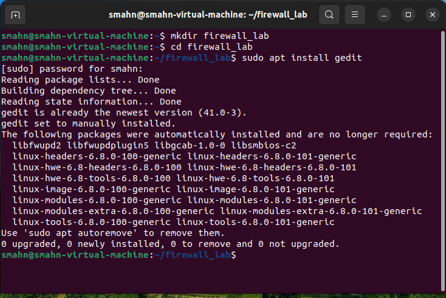<br><em>Figure 4 - Installing gedit</em></p>

**Step 5.** I started a web server on port 8080 with `python3 -m http.server 8080` and opened `http://127.0.0.1:8080` inside Ubuntu. The page loaded (`GET / 200`).

<p align="center">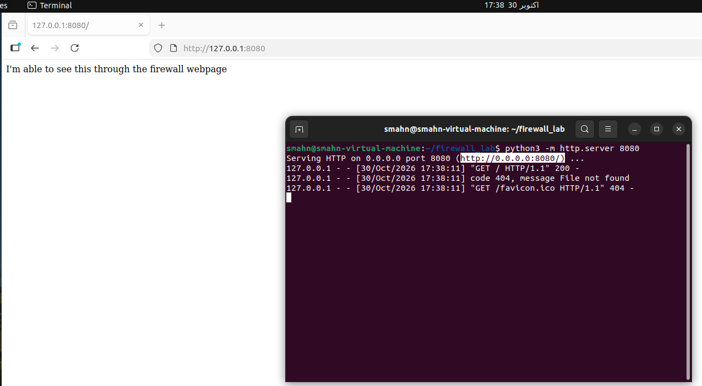<br><em>Figure 5 - Web page works locally</em></p>

**Step 6.** I checked the firewall. UFW was **inactive** (off).

<p align="center">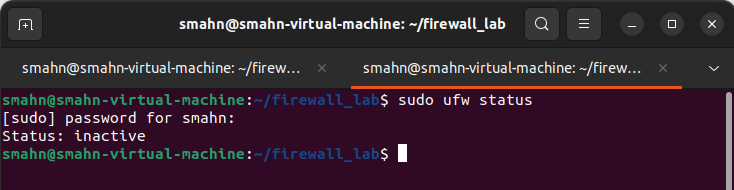<br><em>Figure 6 - UFW is off</em></p>

**Step 7.** `ip a` showed the Ubuntu address: **192.168.18.54**.

<p align="center">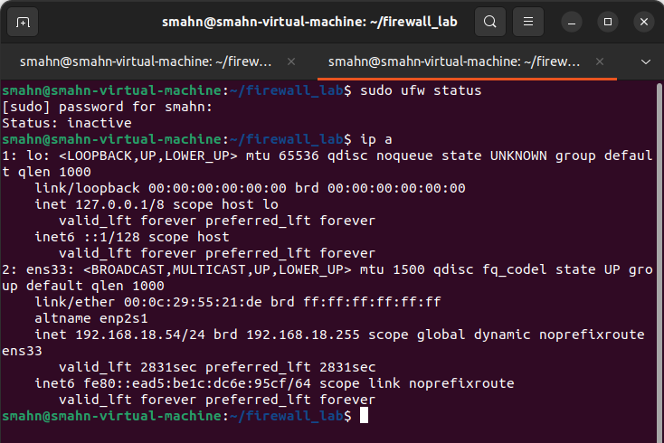<br><em>Figure 7 - Ubuntu IP address</em></p>

**Step 8.** `ipconfig` on Windows showed the host address: **192.168.18.26** (public IPv6 addresses blurred).

<p align="center">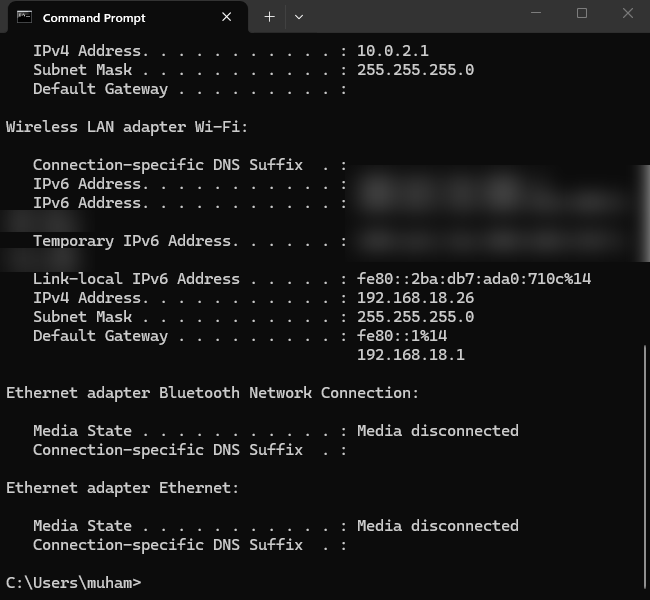<br><em>Figure 8 - Windows host IP address</em></p>

**Step 9.** From Windows, I opened `http://192.168.18.54:8080`. With the firewall off, the page loaded.

<p align="center">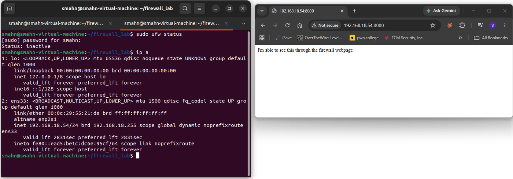<br><em>Figure 9 - Windows reaches the server (firewall off)</em></p>

## Part C - Turn on the firewall

**Step 10.** I turned the firewall on with `sudo ufw enable`. Status is now **active**.

<p align="center">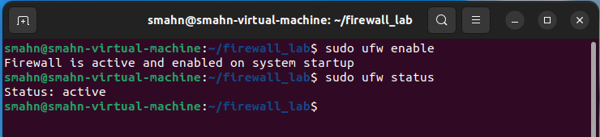<br><em>Figure 10 - UFW turned on</em></p>

**Step 11.** I started the server again and reloaded the page from Windows. It failed with *"This site can't be reached"*, because UFW blocks all incoming traffic by default.

<p align="center">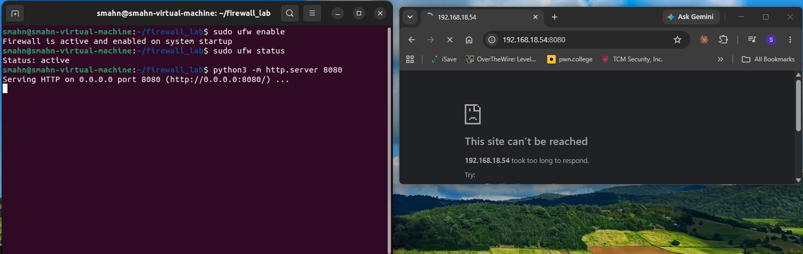<br><em>Figure 11 - Blocked by the default rule</em></p>

**Step 12.** I opened the port with `sudo ufw allow 8080/tcp` (rule added for IPv4 and IPv6). The page loaded from Windows again.

<p align="center">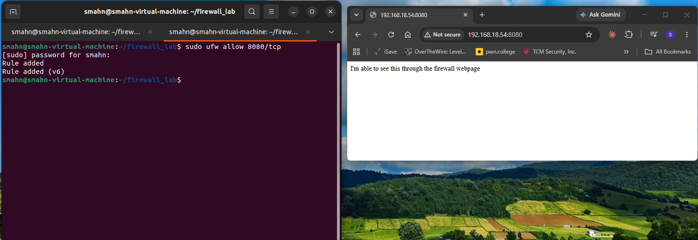<br><em>Figure 12 - Port 8080 allowed, page loads</em></p>

## Part D - Block one computer and test rule order

**Step 13.** I added a rule to block only my Windows computer on port 8080:
`sudo ufw deny from 192.168.18.26 to any port 8080 proto tcp`

<p align="center">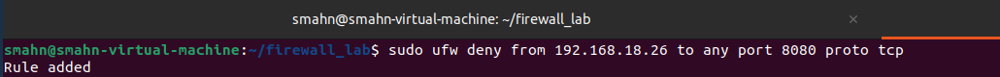<br><em>Figure 13 - Deny rule for the Windows host</em></p>

**Step 14.** The deny rule was placed **below** the allow rule. UFW uses the **first rule that matches**, so the allow rule won and the page **still loaded**.

<p align="center">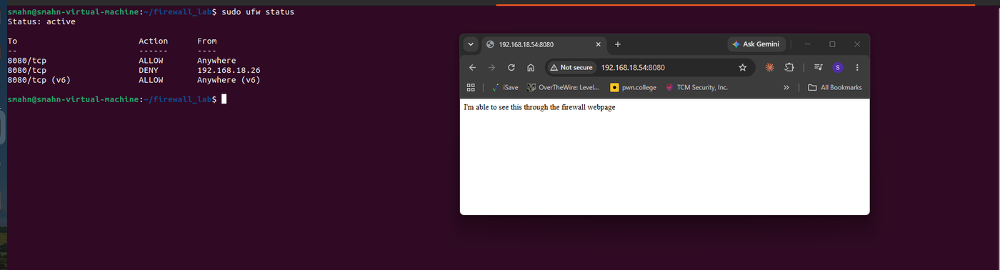<br><em>Figure 14 - Allow rule is first, so the deny rule is never reached</em></p>

**Step 15.** I listed the rules with numbers (`sudo ufw status numbered`) and removed the allow rule with `sudo ufw delete 1`. Now the deny rule was first, and Windows was **blocked**.

<p align="center">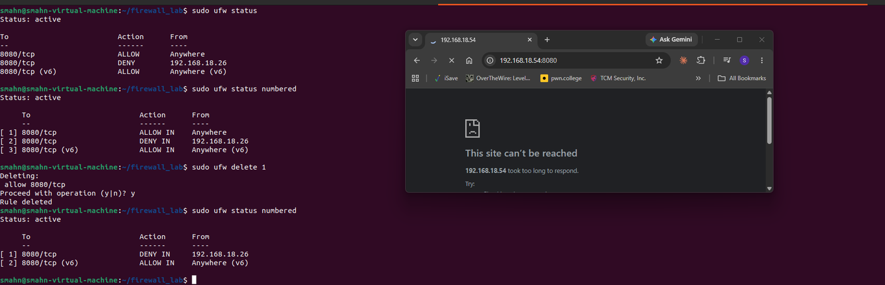<br><em>Figure 15 - Allow rule deleted, Windows host blocked</em></p>

**Step 16.** I added `sudo ufw allow 8080/tcp` again. It went **below** the deny rule, so other computers can reach port 8080 but my Windows computer stays blocked. I tested it from Windows and the page was blocked.

<p align="center">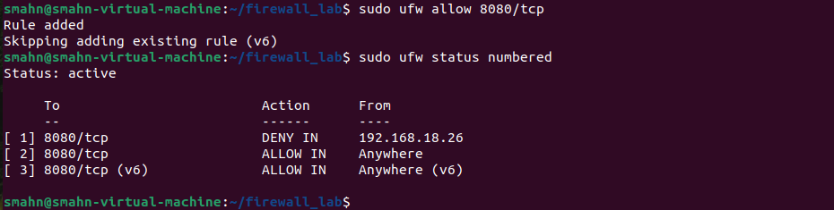<br><em>Figure 16 - Final rules: deny the Windows host first, then allow everyone else</em></p>

### Final rule list

| # | To | Action | From |
|---|---|---|---|
| 1 | 8080/tcp | DENY IN | 192.168.18.26 |
| 2 | 8080/tcp | ALLOW IN | Anywhere |
| 3 | 8080/tcp (v6) | ALLOW IN | Anywhere (v6) |

---

## Test results

All tests were made from the Windows host (`192.168.18.26`) to `http://192.168.18.54:8080`.

| Test | Expected | Result |
|---|---|---|
| Page inside Ubuntu (`127.0.0.1:8080`) | Loads | ✅ Loaded |
| From Windows, firewall off | Loads | ✅ Loaded |
| From Windows, firewall on, no rules | Blocked | ✅ Blocked |
| From Windows, `allow 8080/tcp` | Loads | ✅ Loaded |
| Deny Windows host added **below** allow | Still loads (allow matches first) | ✅ Loaded |
| Allow rule deleted, only deny left | Blocked | ✅ Blocked |
| Allow re-added **below** deny | Windows host blocked | ✅ Blocked |

## Glossary

| Short form | Meaning |
|---|---|
| UFW | Uncomplicated Firewall - the easy firewall tool on Ubuntu |
| VM | Virtual Machine - a computer running inside another computer |
| NAT | Network Address Translation - the virtual machine shares the host's address and is hidden behind it |
| Bridged | The virtual machine joins the home network as its own device |
| IP | Internet Protocol - the address of a device on a network |
| IPv4 / IPv6 | Version 4 / version 6 of IP addresses (`v6` in UFW means IPv6) |
| TCP | Transmission Control Protocol - the connection type web pages use |
| HTTP | HyperText Transfer Protocol - how web pages are sent |
| Port 8080 | The "door" number the test web server listens on |
| `/24` | Subnet size - the first three parts of the address are the same network (255.255.255.0) |
| `sudo` | Run a command as administrator on Linux |
| `apt` | Ubuntu's tool to install software |
| `ip a` | Linux command that shows network addresses |
| `ipconfig` | Windows command that shows network addresses |
| 127.0.0.1 | "This computer" (loopback address) |

## Disclaimer

This lab was built for learning, in my own home lab and on my own network. It is not a production setup. I will further tighten security controls as I keep building on it.

## Repository layout

```
Firewall-Lab/
├── README.md
├── Firewall-Lab.pdf
└── images/
    ├── 01-vm-network-nat.png
    ├── ...
    └── 16-re-add-allow-deny-first.png
```
